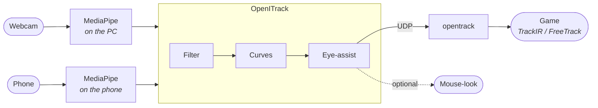

# OpenITrack

Head tracking plus eye-assisted view for flight, racing and space sims, using a plain webcam or your phone. It's free and light on your PC.

- **Webcam mode**: about 8 ms of CPU per frame (MediaPipe face mesh on the CPU). At 30 fps that's roughly a quarter of one core.
- **Phone mode**: your phone does all the tracking in its browser and sends about 0.5 KB per frame over Wi‑Fi. PC cost is close to zero.
- **6DOF head tracking** (yaw, pitch, roll, x, y, z) with TrackIR-style response curves.
- **Eye-assist**: look toward the edge of the screen and the view turns further, like Tobii's extended view. A deadzone lets you glance at instruments without the camera moving, and blinks are ignored.
- **Gaze dot** (optional): a click-through ring on screen showing roughly where you're looking.
- **Guided calibration** (about 40 s) measures your eye range and comfortable head turn, so it fits you without hand-tuning.
- **Per-game profiles** that switch by themselves when the game comes to the front.
- **Global shortcuts** on keyboard, mouse side buttons or **joystick/HOTAS buttons**, with confirmation beeps.
- Works with **any game that supports TrackIR or FreeTrack** (DCS, MSFS, X-Plane, IL-2, Elite Dangerous, ETS2/ATS, Assetto Corsa, rFactor 2, iRacing, War Thunder and more) through [opentrack](https://github.com/opentrack/opentrack). There's also a **mouse-look** output for games without head-tracking support.



## Install

### Option A: the exe (no Python needed)

Unzip `OpenITrack-1.0.0-win64.zip` anywhere and double-click `OpenITrack.exe` inside the `OpenITrack` folder. Keep the `_internal` folder next to the exe. The face model and the phone tracker files are bundled, so everything works offline, including phone mode.

The exe takes the same commands as below, e.g. `OpenITrack.exe run --phone` or `OpenITrack.exe run --preview`. To use them without a terminal, make a shortcut and add the options to its *Target*.

To build the exe yourself:

```bash
.venv\Scripts\pip install -e .[build]
.venv\Scripts\python packaging\build.py
```

This produces `dist\OpenITrack\OpenITrack.exe` and `dist\OpenITrack-<version>-win64.zip`.

### Option B: from source

You need Python 3.12+ on Windows 10/11.

```bash
python -m venv .venv
.venv\Scripts\pip install -e .
```

The face model (3.7 MB) downloads automatically on first run.

### One-time opentrack setup

1. Install [opentrack](https://github.com/opentrack/opentrack/releases) (free).
2. **Input**: `UDP over network`. Click the hammer icon and set the port to `4242`.
3. **Output**: `freetrack 2.0 Enhanced` (covers both TrackIR and FreeTrack games).
4. **Filter**: `Accela` with low smoothing, or `None`. OpenITrack already filters, so heavy smoothing here only adds lag.
5. Mapping curves in opentrack can stay linear, because OpenITrack's own curves do the shaping.
6. Press **Start** in opentrack, then start OpenITrack.

## Use

Double-click `OpenITrack.bat`, or run:

```bash
.venv\Scripts\openitrack run            # webcam
.venv\Scripts\openitrack run --preview  # webcam + tuning window
.venv\Scripts\openitrack run --phone    # phone mode
.venv\Scripts\openitrack calibrate      # tracking + calibration overlay
.venv\Scripts\openitrack buttons        # find names for mouse/joystick buttons
.venv\Scripts\openitrack devices        # list / revoke paired phones
.venv\Scripts\openitrack cameras        # list webcams
.venv\Scripts\openitrack config         # show the config file location
.venv\Scripts\openitrack profiles       # list per-game profiles (--new NAME --app DCS.exe to add one)
.venv\Scripts\openitrack run --profile DCS  # start with a profile
```

### Shortcuts

Shortcuts work while any app or game has focus. Every default needs at least two modifier keys held, so a single keypress meant for the sim never triggers OpenITrack.

| Default | Action |
|---|---|
| **Ctrl+Shift+F9** | Recenter: look at the middle of the screen and press it |
| **Ctrl+Shift+F10** | Pause / resume (the view glides to center and stays) |
| **Ctrl+Shift+F11** | Eye-assist on/off |
| **Ctrl+Shift+F8** | Position tracking (lean x/y/z) on/off |
| **Ctrl+Shift+PageUp / PageDown** | Rotation sensitivity ×1.1 / ÷1.1 (this session) |
| **Ctrl+Alt+Shift+F9** | Start or cancel calibration |
| **Ctrl+Alt+Shift+F10** | Show/hide the tuning window |
| **Ctrl+Alt+Shift+F11** | Gaze dot on/off (this session) |
| *(unset)* `toggle_roll` | Head tilt on/off |
| *(unset)* `freeze_hold` | **Hold**: the view stays where it is, e.g. to read a side panel while looking back at the screen |
| *(unset)* `center_hold` | **Hold**: the view snaps straight ahead, e.g. for aiming |
| *(unset)* `next_profile` | Switch to the next profile (Default, then each profile in turn) |

Change any of them in `[hotkeys]`. Bindings can be:

- **Keyboard**: `"ctrl+shift+F9"`, `"alt+numpad5"`. Modifiers are `ctrl`, `alt`, `shift`, `win`. F12 can't be used because Windows reserves it.
- **Mouse**: `"mouse3"` (middle), `"mouse4"`, `"mouse5"` (side buttons), optionally with modifiers.
- **Joystick / HOTAS / wheel / button box**: `"joy1:button5"`. Run `openitrack buttons` and press the button to get its exact name.

OpenITrack captures keyboard shortcuts, so the game doesn't also see them. Mouse and joystick buttons and the hold actions are not captured, so the game sees those presses too. Pick buttons you haven't bound in the sim. Each shortcut plays a short beep (higher = on, lower = off); set `sounds = false` to silence them.

### Calibration

Run `openitrack calibrate`, or press **Ctrl+Alt+Shift+F9** while tracking. A fullscreen overlay walks you through three parts:

1. **Center**: look at the center dot while sitting how you normally play. This is your neutral pose.
2. **Eye range**: look at dots near the left, right, top and bottom edges and in the four corners, moving only your eyes. If your head moves a lot, it asks you to redo that dot; small head movements are measured and taken out.
3. **Head range**: turn your head left, right, up and down as far as is comfortable while you can still see the screen. That becomes "full turn" in game.

The results are saved to `calibration.json` next to your config and loaded automatically. They replace the gaze ranges and the yaw/pitch `input_range`, and fit the gaze dot to all nine dots (turn the gaze or head part off under `[calibration]`). Run it again whenever your setup changes, or delete it with `openitrack calibrate --reset`. For exclusive-fullscreen games, switch to borderless or alt-tab to the desktop while calibrating, since the overlay can't draw over exclusive fullscreen.

**Multiple monitors.** The overlay opens on your primary monitor. If you play on another one, set `monitor` under `[calibration]` so the dots are where you actually look:

```toml
[calibration]
monitor = 0       # 0 = primary, 1, 2, 3 = monitors counted from the left
# monitor = "all" # span every monitor, e.g. triple screens
```

Run `openitrack monitors` to see the numbers. With `"all"`, the eye-range dots sit near the outer edges of the outer screens, so eye-assist reaches across the whole set.

### Gaze dot

Turn on **Gaze dot** in the window (Settings tab to keep it on, or the switch under Controls for now), or set `enabled = true` under `[overlay]`. A small ring then follows where OpenITrack thinks you're looking. It's drawn on top of everything, never takes focus and lets clicks through. It sits on the `[calibration] monitor` and hides while no face is visible and during calibration.

It's a rough guide, not a precise pointer: a webcam sees each eye in only a few pixels, so expect it to be off by a few centimetres. Calibrate first: a least-squares fit to the nine calibration dots maps your iris position to the screen, corners included. It adds head turns and head movement (sliding sideways, up/down or leaning in) to where your eyes point (`follow_head = false` for eyes only). If head turns move the dot too far or not far enough, set `screen_degrees` to how wide your screen looks from your seat (about 50 for a 27" screen at 60 cm, more for triple screens). Like the calibration overlay, it can't draw over exclusive-fullscreen games.

### Phone mode

1. Phone and PC on the same Wi‑Fi.
2. Run `openitrack run --phone`. It prints the address to open, normally **`https://openitrack.local`**. If your phone can't open `.local` names (some older Android phones), use the IP-address link printed underneath.
3. Open it on the phone. The first time, the browser warns about the certificate. That's expected for a private local address, so tap **Advanced → Proceed**.
4. **Pair once:** the phone shows a 6-character code. Type it into the OpenITrack window on the PC and press Enter. From then on the phone reconnects by itself.
5. Tap **Start tracking**, allow the camera, and mount the phone near the top of your monitor, in portrait or landscape, either way up. If you turn or flip it while tracking, OpenITrack recenters by itself. **Black screen** saves battery, and the page keeps the screen awake.
6. The first time, Windows Firewall asks about OpenITrack/Python. Allow it on **Private** networks only.

Manage paired phones with `openitrack devices`. To unpair one, run `openitrack devices --revoke <id>` (or `--revoke all`). On the phone, **Forget this PC** removes the pairing there.

**Security.** Other people on the same Wi‑Fi can't connect, watch or interfere:

- **Pairing needs the code on your phone's screen, typed on your PC.** The code never travels over the network. The two devices check it with SPAKE2 (RFC 9382), so someone capturing the traffic can't learn it or brute-force it offline. Each attempt by an impostor is a single blind guess against about 900 million possible codes, and a new code is made after every failed try.
- **Every paired phone gets its own 256-bit key.** On the PC it's encrypted with Windows DPAPI, so only your Windows account can use it. On the phone it's stored as a non-extractable browser key.
- **Every connection derives fresh keys.** The PC proves itself before the phone sends anything, and every head-pose message is AES-GCM encrypted with a replay counter. Unpaired devices can't send poses, and captured traffic can't be read, altered or replayed.
- **The server refuses** requests for unknown host names (blocks DNS-rebinding), WebSockets opened from other websites, and IPs with repeated failed attempts. It also limits connections and pending pairings.
- HTTPS is used only because phone browsers require it for the camera. None of the protections above rely on the self-signed certificate.

**Privacy.** Video never leaves the phone: tracking runs in the phone's browser and only head-angle and eye-offset numbers are sent, encrypted, to your PC. The page and all of MediaPipe are served by your PC (pinned by SHA-256), so the phone contacts no other server. A strict Content Security Policy blocks any other connection. The camera is released whenever the page is hidden. Nothing is logged except connection events in your own console.

To use the phone as a plain camera instead, an IP-camera app such as DroidCam works too. Set `camera = "http://PHONE-IP:4747/video"` in the config. That mode runs the tracking on the PC and doesn't have the pairing protections, so use it only on a network you trust.

### Profiles

A flight sim and a racing sim rarely want the same curves. A **profile** gives one game or app its own response curves, eye-assist, filtering and outputs. Everything a profile doesn't set comes from your main config, called **Default**. The camera, calibration, shortcuts and window settings are shared by all profiles.

In the window, open the **Profiles** tab, click **New…** and name it after the game. Under *Switch to it when this is in front*, add the game's program: start the game, then pick it from the list, or type its file name (e.g. `DCS.exe`, `FlightSimulator.exe`). From then on, OpenITrack switches to that profile within a second of the game coming to the front, with a short beep. Switching to a program without a profile (the desktop, a browser, this window) keeps the current one, so alt-tabbing doesn't change anything. You can also pick a profile by hand from the **Profile** list at the top of the window.

While a profile is in use, changes in the window's Settings tab (outputs, eye-assist) are saved to that profile. For curves and filtering, click **Edit file**. A new profile lists every setting it can change with your current Default value, all commented out:

```toml
[profile]
apps = ["DCS.exe"]    # programs that switch to this profile when they're in front

[axes.yaw]
output = 180.0        # removed the # : DCS now turns further
# input_range = 35.0
```

Remove the `#` in front of a setting to change it for that game. Like the main config, profile files apply within a second of saving, even while tracking. They live in the `profiles` folder next to `config.toml`, one `.toml` file each, so you can back them up or share them. Turn automatic switching off with `auto_switch = false` under `[profiles]`.

## Tuning

The config file is `%APPDATA%\OpenITrack\config.toml`. Every setting is commented, and **changes apply live within a second of saving**, so tune while the game runs.

- **An axis moves the wrong way**: set `invert = true` under `[axes.<name>]`.
- **View too twitchy at rest**: lower `[filter] head_min_cutoff` (e.g. 0.4) or raise the axis `deadzone`.
- **View lags behind fast turns**: raise `head_beta` (e.g. 0.12).
- **Need to turn your head too far**: lower `input_range` for that axis. To get more in-game rotation from the same movement, raise `output`.
- **Precise near center, fast at the edges**: raise `exponent` (1.0 is linear).
- **Eye-assist kicks in too easily**: raise `[gaze] deadzone`. To turn it off, set `enabled = false`.
- **Eye-assist or head range feels off**: run the calibration again. To tune by hand instead, run with `--preview`, read the `gaze x/y` values while looking at the screen edges, put them into `horizontal_range` / `vertical_range`, and set `[calibration] use_gaze = false`.
- **Lower CPU**: set `[source] fps = 20`, or `[tracking] blendshapes = false` (skips MediaPipe's
  expression model; blinks are then judged from the eyelid gap). Phone mode is the lightest option.
  The camera's resolution (`[source] width`/`height`) and picture format (`[source] format`:
  `"mjpg"`, `"yuy2"` or `"auto"`) are also in Settings. They change what the camera sends, so
  results change a little too, and how much they save depends on the camera. If a camera can't
  deliver the size you pick, it uses one it can and the log says which.
- **Different settings per game**: make a profile for it (see [Profiles](#profiles)) instead of editing the main config each time.

## Getting good tracking

- Light your face from the front. A lamp behind the monitor ruins webcam tracking.
- Put the camera 50–90 cm from your face with your whole face in view. It can sit above or below any monitor, off to the side, and tilted: OpenITrack measures every movement relative to your neutral head pose, so turning stays pure yaw and leaning toward the screen stays pure z. Recenter (or recalibrate) after you move the camera.
- Glasses work. Strong screen reflections on them can make eye-assist jittery; if that happens, turn eye-assist off with Ctrl+Shift+F11.
- Recenter (Ctrl+Shift+F9) after you shift in your seat.

## Troubleshooting

| Symptom | Fix |
|---|---|
| "Camera … only returned black frames" | Open the privacy shutter. Check Windows Settings → Privacy & security → Camera → *Let desktop apps access your camera*. Close other apps using the camera. |
| Nothing moves in game | Check that opentrack is started and its octopus moves. Check that the game's TrackIR/head-tracking option is on. |
| Octopus moves, game doesn't | Use opentrack output `freetrack 2.0 Enhanced` and start opentrack **before** the game. |
| Phone page says "looking for the PC" / "connecting" | Firewall: allow OpenITrack/Python on private networks. Make sure both devices are on the same Wi‑Fi, not a guest network (those isolate devices). |
| `openitrack.local` doesn't open on the phone | Use the IP-address link printed under it. Some Android versions can't resolve `.local` names. |
| Phone says "this PC no longer recognises this phone" | It was revoked, or the PC's pairing file was reset. Tap **Pair again**. |
| "That code didn't match" | The phone makes a new code after each failed try. Type the one it shows now. |
| Shortcut "already used by another app" | Pick a different combo in `[hotkeys]`. |
| Calibration overlay doesn't appear over the game | The game is in exclusive fullscreen. Switch it to borderless/windowed, or calibrate from the desktop. |
| Calibration overlay is on the wrong monitor | Set `[calibration] monitor` (see `openitrack monitors`), or `"all"` for triple screens. |
| Profile doesn't switch when the game starts | Check the program name in the Profiles tab: pick it from the list while the game is running. Make sure *Switch profiles automatically* is on. |
| Joystick button does nothing | Run `openitrack buttons` and copy the exact name it prints. |

## Development

With GNU make installed (`choco install make` on Windows):

```bash
make setup   # create .venv and install with dev + build extras
make test    # run pytest (make test ARGS="-k phone")
make run     # start the tracker
make calibrate  # start the tracker with the calibration overlay
make build   # run the tests, then build the exe and release zip
make build-force  # build even if the tests fail
make clean   # remove build output and caches
```

Without make:

```bash
.venv\Scripts\pip install -e .[dev]
.venv\Scripts\python -m pytest
```

| Path | What it does |
|---|---|
| `openitrack/features.py` | Head pose and iris gaze. Shared by webcam and phone. |
| `openitrack/mapping.py` | Centering, One Euro filtering, curves, eye-assist, face-loss, pause/freeze/center modes |
| `openitrack/calibration.py` | Calibration state machine and saved results; `calibration_overlay.py` draws it |
| `openitrack/gaze_model.py` | Gaze dot geometry: eye map, least-squares calibration fit, head turn and position |
| `openitrack/monitors.py` | Monitor layout for placing the calibration overlay and gaze dot |
| `openitrack/gaze_overlay.py` | Gaze dot: click-through Win32 window (the screen point comes from `mapping.py`) |
| `openitrack/hotkeys.py` | Global keyboard/mouse/joystick shortcuts |
| `openitrack/sources/` | Webcam (OpenCV + MediaPipe) and phone (HTTPS + WebSocket server, pairing, encrypted sessions) |
| `openitrack/pake.py`, `web/pake.js` | SPAKE2 pairing, both sides checked against the RFC 9382 test vectors |
| `openitrack/devices.py` | Paired phones, secrets protected with DPAPI |
| `openitrack/mdns.py` | `openitrack.local` advertisement |
| `openitrack/web/` | Phone page: `app.js` (UI and tracking), `frame.js` (pose message), `link.js` (secure link) |
| `openitrack/outputs.py` | opentrack UDP packet and mouse-look |
| `openitrack/profiles.py` | Per-game profiles layered over the config; `foreground.py` finds the program in front |
